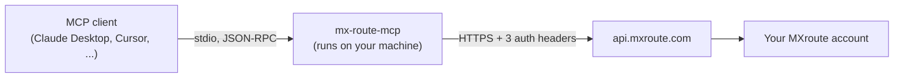

# mx-route-mcp

[](https://github.com/MauiGrowth/mx-route-mcp/actions/workflows/ci.yml)
[](LICENSE)
[](https://nodejs.org)

A [Model Context Protocol](https://modelcontextprotocol.io) (MCP) server for the [MXroute](https://mxroute.com) email hosting API. Connect it to an MCP client such as Claude Desktop, Claude Code or Cursor and manage your MXroute account in plain language: add domains, create mailboxes, set up forwarders, tune spam filtering, look up the DNS records a domain needs, check disk usage, and administer reseller users and packages.

> **Unofficial.** This project is not affiliated with or endorsed by MXroute. It wraps their public [REST API](https://api.mxroute.com/docs).

- **Complete.** One tool for each of the 43 operations in the MXroute API, kept honest by a test that compares the tool list with the API's operation list.
- **Guard rails built in.** Every tool carries MCP behaviour hints (read-only / destructive / idempotent) so clients can ask before deleting anything, and destructive tools say so in their description. A read-only mode and per-area toolsets let you hand an assistant only what it needs.
- **Private.** Your API key lives in the server's environment. By default it is sent only to `api.mxroute.com` over HTTPS, never logged, and never shown to the model.

## Contents

- [What you can ask it](#what-you-can-ask-it)
- [Quick start](#quick-start)
- [Using it](#using-it)
- [How it works](#how-it-works)
- [Configuration](#configuration)
- [Resellers](#resellers)
- [Tool reference](#tool-reference)
- [Security](#security)
- [Troubleshooting](#troubleshooting)
- [Project status](#project-status)
- [Development](#development)
- [About Maui Growth](#about-maui-growth)

## What you can ask it

- "Which domains are on my MXroute account, and how many mailboxes does each have?"
- "I want to add `example.org`. What DNS record do I need to create first?"
- "Create a mailbox `support@example.com` with a 5 GB quota and forward `sales@example.com` to `me@example.net`."
- "Which mailboxes are using the most disk space?"
- "Show me the MX, SPF and DKIM records for example.com."
- "Add `*@spam-domain.example` to my spam blacklist (account-wide) and raise the spam auto-delete score on example.com to 15."

## Quick start

**Requirements:** Node.js 20 or newer, an MXroute account, and an MCP client.

### 1. Get your credentials

Create an API key on the [MXroute API keys page](https://panel.mxroute.com/api-keys.php). The page shows three values; the key is displayed once, so copy it when it is created.

| Variable | What it is | Example |
| --- | --- | --- |
| `MXROUTE_SERVER` | Your mail server hostname (the "X-Server" value) | `eagle.mxlogin.com` |
| `MXROUTE_USERNAME` | Your DirectAdmin username (the "X-Username" value), or `reseller\|user` — see [Resellers](#resellers) | `johndoe` |
| `MXROUTE_API_KEY` | The complete API key, unchanged, colons included | `Mx8d98…` |

### 2. Add the server to your client

The server is started with `npx`, which downloads and builds it from this repository on first use (this takes a few seconds, once):

```
npx -y github:MauiGrowth/mx-route-mcp
```

**Claude Desktop** — add this to `claude_desktop_config.json` (Settings → Developer → Edit Config), then restart the app:

```json
{
  "mcpServers": {
    "mxroute": {
      "command": "npx",
      "args": ["-y", "github:MauiGrowth/mx-route-mcp"],
      "env": {
        "MXROUTE_SERVER": "eagle.mxlogin.com",
        "MXROUTE_USERNAME": "your_directadmin_username",
        "MXROUTE_API_KEY": "your_complete_api_key"
      }
    }
  }
}
```

**Claude Code**

```bash
claude mcp add mxroute \
  --env MXROUTE_SERVER=eagle.mxlogin.com \
  --env MXROUTE_USERNAME=your_directadmin_username \
  --env MXROUTE_API_KEY=your_complete_api_key \
  -- npx -y github:MauiGrowth/mx-route-mcp
```

**Cursor and other clients** — Cursor uses the same `mcpServers` JSON as Claude Desktop (in `.cursor/mcp.json`). Any client that can launch a stdio MCP server works: run the `npx` command above with the three environment variables set.

> **Prefer to build it yourself?** Clone the repo, run `npm install` (this also builds it), and point your client at `node /absolute/path/to/mx-route-mcp/dist/index.js` instead of `npx`. That also avoids the first-run build delay.

### 3. Check it works

```bash
MXROUTE_SERVER=eagle.mxlogin.com MXROUTE_USERNAME=you MXROUTE_API_KEY=... \
  npx -y github:MauiGrowth/mx-route-mcp --check
```

This lists your domains once and prints `OK: authenticated to … ; N domains found.` Nothing is modified. Then restart your client and ask: *"Which domains are on my MXroute account?"*

For a fuller read-only check of every list/get tool against your own account, from a clone of this repo:

```bash
npm install
MXROUTE_SERVER=eagle.mxlogin.com MXROUTE_USERNAME=you MXROUTE_API_KEY=... npm run smoke:live
```

It starts the server in read-only mode (write tools are not registered, so nothing can change), calls each read tool, and prints only pass/fail with counts, never domain names or addresses. Reseller tools are reported as skipped on non-reseller accounts.

## Using it

Just describe what you want. The assistant picks the tools, fills in the arguments, and tells you what happened. For example:

> **You:** Add a mailbox `orders@example.com` with a 2 GB quota and forward `sales@example.com` to it.
>
> **Assistant:** *(calls `create_email_account` with `domain: "example.com"`, `username: "orders"`, `quota: 2048`, then `create_forwarder` with `alias: "sales"`, `destinations: ["orders@example.com"]`)* Done: `orders@example.com` exists with a 2 GB quota, and mail to `sales@example.com` now forwards to it.

A few things worth knowing:

- **Destructive actions ask first.** Deleting a mailbox, domain, forwarder or user, changing a password, or switching a catch-all to `blackhole` are marked destructive. Most clients show a confirmation prompt for those, and the assistant is told to confirm with you.
- **Passwords go through the conversation.** If you ask the assistant to create a mailbox, the password is part of your chat. See [Security](#security).
- **Adding a domain needs proof of ownership.** The assistant fetches the verification record (`get_domain_verification_key`) and asks *you* to create it at your DNS provider; this server cannot change DNS. After DNS propagates (typically 5–15 minutes) it can add the domain.
- **Names are bare.** Mailbox and forwarder names are the part before the `@`; domains are plain names like `example.com`. Mistakes are rejected with a message the assistant can act on, as are misspelled arguments.
- **Spam lists are account-wide.** Whitelist/blacklist entries apply to every domain on the account. The `domain` argument only has to be one you own.

## How it works



The server is a small local program. Your MCP client starts it as a child process and talks to it over stdin/stdout; it holds your credentials in its environment and makes HTTPS calls to the MXroute REST API on the assistant's behalf. Nothing is hosted, and nothing is sent anywhere except MXroute.

**What happens on a request:**

1. **Startup.** The client launches the server with your environment variables. The server registers its tools (all 43, or fewer if you set `MXROUTE_READ_ONLY` or `MXROUTE_TOOLSETS`) and tells the client each tool's name, description, argument schema and behaviour hints (read-only, destructive, idempotent). It starts even without credentials; they are checked on the first call.
2. **Tool call.** The assistant chooses a tool and arguments. The server validates them against a strict schema: required fields, types, ranges (a send limit of 9600, a spam score of 1–50), and the shapes the API expects. Unknown or misspelled arguments, full email addresses where a name belongs, and URLs where a domain belongs are rejected before anything is sent.
3. **Mapping to the API.** Each tool is bound to exactly one API operation, for example `POST /domains/{domain}/email-accounts`. Path parameters are filled from the arguments (URL-encoded, with `.`/`..` rejected) and the remaining arguments become the JSON body.
4. **The HTTP call.** The server adds the `X-Server`, `X-Username` and `X-API-Key` headers and sends the request with a timeout. It never follows redirects (which could forward your key to another host) and never retries (a retried write could apply twice).
5. **The result.** The `{success, data}` envelope is unwrapped; a `204 No Content` becomes a plain confirmation message; API errors become readable tool errors with the code, message and field (for example `VALIDATION_ERROR` on `password`); any field that looks like a credential is masked; and compact JSON goes back to the assistant. If a write times out, the error says the change may or may not have been applied, so the assistant checks the current state before trying again.

**Worked example.** The request *"create a mailbox `orders@example.com` with a 2 GB quota"* becomes:

```jsonc
// tool call
{ "name": "create_email_account",
  "arguments": { "domain": "example.com", "username": "orders", "password": "…", "quota": 2048 } }
```

```http
POST https://api.mxroute.com/domains/example.com/email-accounts
X-Server: eagle.mxlogin.com
X-Username: johndoe
X-API-Key: ********
Content-Type: application/json

{ "username": "orders", "password": "…", "quota": 2048 }
```

**Where things live:**

| Path | Responsibility |
| --- | --- |
| `src/tools/*.ts` | One `tool({...})` per API operation: name, description, argument schema, the operation it calls. Grouped by area (domains, mailboxes, spam, quota, reseller). |
| `src/tools/define.ts` | The `tool()` factory and `runTool`: fills path parameters, builds the body, derives the MCP hints from the HTTP method (GET = read-only, DELETE = destructive). |
| `src/client.ts` | The HTTP client: auth headers, timeout, no redirects, response unwrapping, error mapping. |
| `src/config.ts` | Reads and validates the environment variables. |
| `src/server.ts` | Registers the tools with the MCP SDK, formats results and errors. |
| `src/redact.ts` | Masks credential-looking fields in responses. |
| `src/index.ts` | The command-line entry point (`--check`, `--tools`, `--version`, stdio server). |

Because a tool *declares* the operation it calls and the request is built from that declaration, a tool cannot claim to do one thing and send another. A test calls every tool and asserts the exact method, path and body it produces, and another compares the tool list with the API's operation list.

## Configuration

| Variable | Default | Purpose |
| --- | --- | --- |
| `MXROUTE_SERVER` | – (required) | Mail server hostname. A pasted `https://…` URL is accepted and trimmed. |
| `MXROUTE_USERNAME` | – (required) | DirectAdmin username, or `reseller\|user`. |
| `MXROUTE_API_KEY` | – (required) | API key password. |
| `MXROUTE_READ_ONLY` | `false` | `true` registers only the read-only tools; the write tools do not exist for the assistant at all. Accepts `true`/`false`, `1`/`0`, `yes`/`no`, `on`/`off`; anything else is a startup error rather than silently leaving writes enabled. |
| `MXROUTE_TOOLSETS` | `all` | Comma-separated subset of toolsets (`account`, `domains`, `pointers`, `mailboxes`, `forwarders`, `spam`, `dns`, `catchall`, `quota`, `reseller_users`, `reseller_packages`), for example `domains,mailboxes,dns`. Unknown names are a startup error. |
| `MXROUTE_TIMEOUT_MS` | `30000` | Per-request timeout (1000–300000). |
| `MXROUTE_API_URL` | `https://api.mxroute.com` | Override the API origin. Must be HTTPS (plain HTTP only for `localhost`), with no credentials, query string or fragment. Intended for testing; credentials are sent to whatever host you set here. |

If the credentials are missing the server still starts and lists its tools; each tool call then returns an error naming the missing variables. `--check` and `--tools` read the same variables, so run them with the values from your client config.

### Giving an assistant less power

For an assistant that should only *look*:

```json
"env": { "MXROUTE_READ_ONLY": "true", "…": "…" }
```

For one that manages mailboxes and forwarders but cannot touch domains, spam rules or reseller accounts:

```json
"env": { "MXROUTE_TOOLSETS": "mailboxes,forwarders", "…": "…" }
```

Reseller tools are registered by default but only work for reseller accounts. If you are not a reseller, drop them with `MXROUTE_TOOLSETS` to keep the tool list short. If you restrict toolsets, keep `account` and `dns` alongside `domains` if you want the assistant to be able to walk you through adding a domain.

## Resellers

Reseller endpoints (`reseller_users`, `reseller_packages`) work when `MXROUTE_USERNAME` is your plain reseller username.

To manage one of your users' domains and mailboxes, set `MXROUTE_USERNAME=reseller|user` and keep using the **reseller's** API key. All domain and mailbox tools then act on that user. Per the API documentation:

- each name is 1–16 letters, digits or underscores; chained pipes and self-impersonation are rejected (use the plain username for your own account);
- only ordinary user accounts can be impersonated (not admins, and not user-to-user);
- the key's DirectAdmin restrictions still apply, and must permit session queries, impersonation and the action you want;
- reseller-only endpoints are unavailable while impersonating, and the reseller and every impersonated user share one rate-limit bucket.

To switch users, run a second server entry with a different `MXROUTE_USERNAME`.

## Tool reference

Tool types: **read** tools never change anything; **write** tools create or modify; **destructive** tools delete data, overwrite a password, interrupt service, or change a setting that can cause mail to be discarded (catch-all, mail hosting status, the spam auto-delete threshold). MCP clients that honour the `destructiveHint` annotation can ask for confirmation before running them, and each destructive tool's description also tells the assistant to confirm first.

<!-- tools:start -->

**Account** — toolset `account`

| Tool | Type | API call | Description |
| --- | --- | --- | --- |
| `get_domain_verification_key` | read | `GET /verification-key` | Returns the account's domain verification key and the DNS TXT record that proves ownership of a domain. |

**Domains** — toolset `domains`

| Tool | Type | API call | Description |
| --- | --- | --- | --- |
| `list_domains` | read | `GET /domains` | Lists the names of all domains on the MXroute account. |
| `get_domain` | read | `GET /domains/{domain}` | Returns details for one domain: whether mail hosting is enabled, whether SSL is enabled, and its domain pointers. |
| `create_domain` | write | `POST /domains` | Adds a domain to the account. |
| `delete_domain` | **destructive** | `DELETE /domains/{domain}` | Permanently removes a domain from the account (irreversible); mailboxes and forwarders under the domain are affected. |
| `set_mail_hosting_status` | **destructive** | `PATCH /domains/{domain}/mail-status` | Enables or disables mail hosting for a domain. |

**Domain pointers** — toolset `pointers`

| Tool | Type | API call | Description |
| --- | --- | --- | --- |
| `list_domain_pointers` | read | `GET /domains/{domain}/pointers` | Lists the domain pointers (aliases and redirects) that point at a domain. |
| `create_domain_pointer` | write | `POST /domains/{domain}/pointers` | Creates a domain pointer so that another domain points at `domain` (the target). |
| `delete_domain_pointer` | **destructive** | `DELETE /domains/{domain}/pointers/{pointer}` | Removes a domain pointer from a domain. |

**Email accounts** — toolset `mailboxes`

| Tool | Type | API call | Description |
| --- | --- | --- | --- |
| `list_email_accounts` | read | `GET /domains/{domain}/email-accounts` | Lists the mailboxes on a domain with quota (MB, 0 = unlimited), current usage (MB), daily send limit, emails sent today and suspended state. |
| `get_email_account` | read | `GET /domains/{domain}/email-accounts/{username}` | Returns quota, usage, daily send limit, emails sent today and suspended state for one mailbox. |
| `create_email_account` | write | `POST /domains/{domain}/email-accounts` | Creates a mailbox such as `username@domain`. |
| `update_email_account` | **destructive** | `PATCH /domains/{domain}/email-accounts/{username}` | Changes a mailbox's password, quota or daily send limit. |
| `delete_email_account` | **destructive** | `DELETE /domains/{domain}/email-accounts/{username}` | Permanently deletes a mailbox and the mail stored in it (irreversible). |

**Forwarders** — toolset `forwarders`

| Tool | Type | API call | Description |
| --- | --- | --- | --- |
| `list_forwarders` | read | `GET /domains/{domain}/forwarders` | Lists the email forwarders on a domain and the destinations each one forwards to. |
| `create_forwarder` | write | `POST /domains/{domain}/forwarders` | Creates a forwarder `alias@domain` that sends mail to one or more destinations; the special destination `:blackhole:` silently discards all mail to it (confirm with the user first) and `:fail:` rejects it. |
| `delete_forwarder` | **destructive** | `DELETE /domains/{domain}/forwarders/{alias}` | Deletes an email forwarder. |

**Spam filtering** — toolset `spam`

| Tool | Type | API call | Description |
| --- | --- | --- | --- |
| `get_spam_settings` | read | `GET /domains/{domain}/spam/settings` | Returns the spam filter settings for a domain. |
| `update_spam_settings` | **destructive** | `PATCH /domains/{domain}/spam/settings` | Sets the high_score threshold (1-50) for automatic deletion of spam. |
| `list_spam_whitelist` | read | `GET /domains/{domain}/spam/whitelist` | Lists the account-wide whitelist: sender entries that are never treated as spam. |
| `add_spam_whitelist_entry` | write | `POST /domains/{domain}/spam/whitelist` | Adds a sender email or wildcard pattern to the account-wide whitelist so its mail bypasses spam filtering on every domain. |
| `remove_spam_whitelist_entry` | **destructive** | `DELETE /domains/{domain}/spam/whitelist/{entry}` | Removes an entry from the account-wide spam whitelist. |
| `list_spam_blacklist` | read | `GET /domains/{domain}/spam/blacklist` | Lists the account-wide blacklist: sender entries that are always treated as spam. |
| `add_spam_blacklist_entry` | write | `POST /domains/{domain}/spam/blacklist` | Adds a sender email or wildcard pattern to the account-wide blacklist so its mail is always treated as spam on every domain. |
| `remove_spam_blacklist_entry` | **destructive** | `DELETE /domains/{domain}/spam/blacklist/{entry}` | Removes an entry from the account-wide spam blacklist. |

**DNS** — toolset `dns`

| Tool | Type | API call | Description |
| --- | --- | --- | --- |
| `get_dns_records` | read | `GET /domains/{domain}/dns` | Returns the DNS records to configure at the registrar for a domain: MX records, SPF, DKIM (when available) and the verification record. |

**Catch-all** — toolset `catchall`

| Tool | Type | API call | Description |
| --- | --- | --- | --- |
| `get_catch_all` | read | `GET /domains/{domain}/catch-all` | Returns how mail to non-existent addresses on a domain is handled: fail, blackhole or address. |
| `set_catch_all` | **destructive** | `PATCH /domains/{domain}/catch-all` | Sets how mail to non-existent addresses on a domain is handled: type=fail rejects it, type=blackhole silently discards it (mail is lost), type=address forwards it to `address`. |

**Quota** — toolset `quota`

| Tool | Type | API call | Description |
| --- | --- | --- | --- |
| `get_quota` | read | `GET /quota` | Returns the account's overall disk usage: bytes used, quota limit in bytes (0 = unlimited), percent used, a breakdown by category (email, web, databases, backups, other) and grace-period status if over quota. |
| `get_email_usage` | read | `GET /quota/email` | Returns disk usage in bytes for every mailbox on the account, largest first. |

**Reseller: users** — toolset `reseller_users`

| Tool | Type | API call | Description |
| --- | --- | --- | --- |
| `list_reseller_users` | read | `GET /reseller/users` | Lists the usernames of all user accounts under the reseller. |
| `get_reseller_user` | read | `GET /reseller/users/{username}` | Returns a user's email, primary domain, package, suspended state and disk quota. |
| `create_reseller_user` | write | `POST /reseller/users` | Creates a new user account under the reseller, assigned to an existing package. |
| `update_reseller_user` | **destructive** | `PATCH /reseller/users/{username}` | Changes a user's disk quota and/or password. |
| `delete_reseller_user` | **destructive** | `DELETE /reseller/users/{username}` | Permanently deletes a user account and everything in it (domains, mailboxes, mail); irreversible. |
| `suspend_reseller_user` | **destructive** | `POST /reseller/users/{username}/suspend` | Suspends a user account, which interrupts their service until unsuspended. |
| `unsuspend_reseller_user` | write | `POST /reseller/users/{username}/unsuspend` | Restores a suspended user account. |
| `change_reseller_user_package` | write | `PATCH /reseller/users/{username}/package` | Assigns a different package to a user. |

**Reseller: packages** — toolset `reseller_packages`

| Tool | Type | API call | Description |
| --- | --- | --- | --- |
| `list_packages` | read | `GET /reseller/packages` | Lists the names of the reseller's packages. |
| `get_package` | read | `GET /reseller/packages/{name}` | Returns a package's limits: disk quota (GB), domains, mailboxes, forwarders and domain pointers. |
| `create_package` | write | `POST /reseller/packages` | Creates a package. |
| `update_package` | write | `PATCH /reseller/packages/{name}` | Changes a package's limits. |
| `delete_package` | **destructive** | `DELETE /reseller/packages/{name}` | Deletes a package. |

<!-- tools:end -->

Notes on behaviour:

- Mailbox names and forwarder aliases are the part **before** the `@`; domain arguments are bare names such as `example.com` (no URL, no `@`). Mistakes are rejected locally with a message the assistant can act on.
- Misspelled or unknown arguments are rejected, not silently ignored.
- Spam whitelist and blacklist entries are **account-wide**: they apply to every domain on the account. The `domain` argument only has to be one you own.
- `create_forwarder` with the special destination `:blackhole:` silently discards all mail to that address, and `set_catch_all` with `blackhole` does the same for unknown addresses. `update_spam_settings` controls how aggressively spam is auto-deleted. Those, and every delete, are flagged destructive.
- If a write times out or the connection drops, the change may or may not have been applied; the error says so, and the assistant should read the current state before retrying.
- The documented API responses contain no passwords, and the server masks string fields whose names contain `password`, `passwd`, `passphrase`, `api_key`/`apiKey`, `secret` or `token` as a precaution. (A bare `key` field is left alone: the domain verification key is public.)
- Package limits and reseller user quotas accept a number or the string `unlimited`. (The API wants strings; the tools convert for you.)
- Deleting a domain pointer, forwarder, mailbox, domain, user or package is immediate and cannot be undone.
- Adding a domain requires proof of ownership: call `get_domain_verification_key`, create the TXT record it describes, wait for DNS to propagate, then `create_domain`.

### Not covered

The MXroute API does not expose reading or sending mail, webmail, autoresponders, DKIM key management or DNS record creation, so this server cannot do those things. `get_dns_records` tells you what to configure at your registrar; it does not change DNS.

## Security

This is an administration tool. Read these before pointing an assistant at a production account.

- **Passwords pass through the conversation.** `create_email_account`, `update_email_account`, `create_reseller_user` and `update_reseller_user` take a password as an argument, so the password you give the assistant is part of the chat transcript and is sent to your model provider. Use throwaway passwords that the mailbox owner changes on first login, or generate them yourself and keep them out of the chat.
- **Use a dedicated API key** created for this purpose, restricted in the MXroute/DirectAdmin panel to what you need (if you use reseller impersonation, the key must still permit it), and revoke it when you stop using it. The server never writes the key anywhere, but your MCP client's config file holds it in plain text: keep that file private and out of version control.
- **Prefer `MXROUTE_READ_ONLY=true`** unless you actually want changes made, and keep a human confirmation step on the destructive tools in your client.
- **Network behaviour.** Requests go only to `MXROUTE_API_URL` (default `https://api.mxroute.com`). Redirects are never followed, so credentials cannot be forwarded to another host. There are no automatic retries: every call is made exactly once.
- **Logging.** While serving, nothing is logged except a one-line startup banner on stderr. The `--check`, `--tools` and `--help` commands print to the terminal. Error messages returned to the assistant never include your credentials or the request body; text the MXroute API itself puts in an error is passed through, flattened to one line and capped at 500 characters.
- **Rate limits** enforced by MXroute: 200 reads/min, 60 writes/min and 10 bulk/import requests/min per server. A `429` is reported to the assistant with the retry delay.

See [SECURITY.md](SECURITY.md) for how to report a vulnerability.

## Troubleshooting

| Symptom | Likely cause |
| --- | --- |
| `UNAUTHORIZED` / HTTP 401 | Wrong server, username or key. Send the key unchanged: do not prepend a key ID, and make sure you copied the whole key (it is about 32 characters and starts with `Mx`). If you use your account password instead of a key, DirectAdmin must allow it (`api_with_password=yes`). |
| 401/403 when `MXROUTE_USERNAME` is `reseller\|user` | The key must be the reseller's own, the target must be an ordinary user you own, names are 1–16 letters/digits/underscores, and the key's DirectAdmin restrictions must permit impersonation. |
| HTTP 403 on `reseller_*` tools | The account is not a reseller, or `MXROUTE_USERNAME` is in `reseller\|user` form (reseller-only endpoints are unavailable while impersonating). |
| `create_domain` is rejected | The `_da-verify-…` TXT record is missing or has not propagated yet. |
| Mailbox password rejected | Mailbox passwords are 8–72 characters and must satisfy the mail server's strength rules; the error names the field. |
| `Rate limit reached. Retry after N seconds` | MXroute's limits (200 reads, 60 writes per minute). Wait and retry. |
| `did not respond within N ms` / `Could not reach the MXroute API` | Network or DNS problem, or a wrong `MXROUTE_API_URL`. For a write, the change may or may not have been applied: read the current state before retrying. |
| `Unexpected redirect` / `non-JSON response` | `MXROUTE_API_URL` points at something that is not the MXroute API. |
| Server exits at startup with `Configuration error` | A bad `MXROUTE_TOOLSETS`, `MXROUTE_READ_ONLY` or `MXROUTE_API_URL` value; the message says which. Clients usually just show "server disconnected": run the command in a terminal to see it. |
| `must contain only printable ASCII characters` | A stray non-ASCII character (smart dash, zero-width space) came along when the value was copied. |
| Tools missing | `MXROUTE_READ_ONLY` or `MXROUTE_TOOLSETS` is filtering them. Run `npx -y github:MauiGrowth/mx-route-mcp --tools` with the same variables as your client config, e.g. `MXROUTE_READ_ONLY=true npx -y github:MauiGrowth/mx-route-mcp --tools`. |
| The server is slow to appear the first time | `npx` is building it from source on first use. Clone and build it yourself (see the tip in Quick start) to avoid the delay. |

## Project status

- **Verified against a live MXroute account:** authentication, and every list/get tool (domains, pointers, DNS records, catch-all, mailboxes, forwarders, spam settings and lists, quotas, verification key). The real responses match the API's OpenAPI description, including the `/quota` endpoints that are returned without the usual `{success, data}` wrapper.
- **Verified only against the API specification and a mock server:** every write tool (create, update, delete), the reseller tools' success paths, and reseller impersonation. If you try them, make your first writes on a throwaway object, and please [open an issue](https://github.com/MauiGrowth/mx-route-mcp/issues) if anything behaves differently from the docs.
- **Automated tests:** 100+ tests run on every push against a local mock API on Node 20, 22 and 24 (Linux). The suite calls every tool and asserts the HTTP method, path and body it produces. macOS was used for development; Windows is untested.
- **API drift:** a weekly CI job compares the live OpenAPI document with the tool list and fails if MXroute adds or removes an operation. It does not detect changed fields or limits.

## Development

```bash
git clone https://github.com/MauiGrowth/mx-route-mcp.git
cd mx-route-mcp
npm install         # installs dependencies and builds dist/
npm test            # builds, then runs all tests against a local mock API
npm run typecheck
node dist/index.js --tools
```

The automated tests never contact MXroute: they spawn the built server over stdio and talk to a local mock API. `npm run smoke:live` is the opt-in counterpart that checks the read tools against a real account.

Other scripts:

- `npm run check:spec` builds, fetches the live OpenAPI document and fails if the API has an operation no tool covers or a tool targets an operation that no longer exists. `npm run check:spec -- --write` refreshes `spec/operations.json`.
- `npm run docs:tools` regenerates the tool table above from the code; CI fails if it is stale.

### Adding or changing a tool

Tools live in `src/tools/`. Each is one `tool({...})` call that names the API operation (`"POST /domains/{domain}/forwarders"`), its zod arguments and a description written for the model. Path parameters are filled from the arguments and the remaining arguments become the JSON body, so the declared operation and the actual request cannot disagree. Behaviour hints default from the HTTP method (GET is read-only, DELETE is destructive).

To cover a new API operation: add the tool, add a row to the table in `test/tools.test.mjs`, refresh the recorded operations with `npm run check:spec -- --write`, regenerate the README table with `npm run docs:tools`, and open a pull request. The tests pin which tools are destructive and non-idempotent, so changing a hint is a deliberate edit to that list. Design rationale is in [DECISIONS.md](DECISIONS.md).

## About Maui Growth

mx-route-mcp is built and maintained by [Maui Growth](https://mauigrowth.co), a top website design and marketing agency on the island of Maui.

## License

[MIT](LICENSE)
